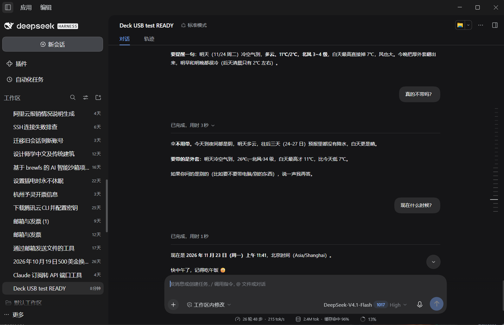
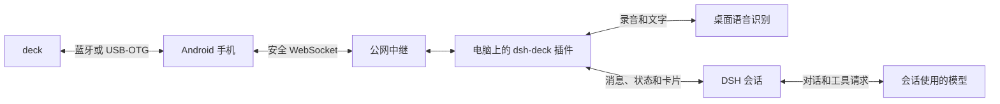

# 按住对讲机说句话，DeepSeek Harness 回了一个 7

这台 OpenWalkieTalkie 是我参加 RustChinaConf 时收到的礼物。下面这张照片里，它正催我吃午饭。

再看电脑上那一头。当时我在 DeepSeek Harness（DSH）的测试会话里问了句「现在什么时候？」。助手报完时间，顺带说了一句「快中午了，记得吃午饭」。桌面上加粗的时间，到了小屏幕上，两边的星号都露出来了。两张图拍的是同一条回复。

谢谢 RustChinaConf 的这份礼物，也要谢谢 OpenWalkieTalkie 的开发者。这台 Rev A 有一块 480 × 480 的屏幕、一个滚轮，还有一颗按住就能说话的键。项目把电路设计、Rust 固件和电脑端程序都公开了。我们后来给蓝牙加功能，第一步就是翻他们写的设备协议。官网 `openwalkietalkie.org` 上有个可以直接玩的演示，手边没机器也能试试它的界面。

## 先借手机一根线

刚开始，deck 得插在电脑上。线一拔，名册就没了。它自己没有 Wi-Fi，我手边倒是有台能上网的荣耀手机，于是先拿一根 USB-C 数据线，把这两样东西插在一起。手机弹窗问要不要允许访问 USB 设备，我点了允许。我们的小程序发出一句 `hello`，deck 答了，顺便报上自己的固件版本 `0.14.0`。我又点了一次「开始测试」，它又答了一遍。

蓝牙就没这么顺利。手机搜得到 deck，也读得出麦克风的音频参数，偏偏拿不到收发按键和名册用的 HID 接口。这台荣耀的系统把相应权限留给了系统应用。最后我们改了 deck 的固件，单独开了一个需要配对加密的蓝牙 GATT 服务，让手机能发名册、收按键。麦克风原本就能用，继续走原来的服务。

## 那个 7 是怎么回来的

有线语音测试时，我在 deck 上选好一个正在运行的助手，按住侧面的 PTT，说「请只回复数字七」，松手。电脑的对话里先多出一条用户消息，下一条是助手写的 `7`。到这里我才敢说，这句话真的送进刚才选的会话了。

中间各台机器干的活，可以顺着这张图看。

我按下 PTT 的时候，桌面的插件先记住我选了哪个会话。deck 把声音压缩成一帧帧音频，手机收到就经中继转发。松手以后，电脑把收到的音频解码，交给语音识别。那次用的是 SenseVoice。转出来的文字会在 deck 上显示，同时作为我的一条新消息写进 DSH。接下来，助手能看到前面的聊天，也知道这个会话有哪些工具可用，跟我坐回电脑前打字一样。

如果模型要调用工具，DSH 会检查权限，需要我同意时就发来一张卡片。我在真机上见到的第一张命令审批写着 `Allow pwsh?`。我用滚轮选了 `Reject`，电脑那头记下 `rejected`，命令没有执行。第二张我选了 `Allow once`，只放行这一次。执行结果会回到会话，模型可以据此接着回答。普通的单选提问也能这么答，手边要是正好拿着手机，直接在手机上选就行。

所以现在我可以拔掉 deck 的线，靠电池和蓝牙用它。电脑还得开着，它负责跑 DSH、转录和执行工具，公网服务器只管转发。

## 第七次松手，屏幕还在听

调蓝牙语音时，我们用的是加了手机控制接口的 0.14 测试固件。有一版一连录了六次都正常。第七次，我已经松开侧键，屏幕还停在「正在聆听」。翻电脑上的日志，那次总共只收到 20 帧音频，后面既没有松键消息，也没有表示录音结束的那一帧。前面六次都能用，让这次卡死格外难查。

后来我们改了固件里给蓝牙控制器发数据的那段代码。队列有地方放下整个包才写，放不下就过一会儿再试，最多等半秒。再刷回真机，我说完第一句话，松开手，先去拨了一下滚轮。「正在聆听」退了，光标也跟着动了。这个松开 PTT 后卡在「正在聆听」的问题，后来在我们用的 0.14 固件里修好了。

日常用起来，我反倒很喜欢一个更简单的功能。最早名册里只有正在运行的助手，可我想找的常常是刚刚干完活的那个。现在按方向键翻到「历史会话」，转一下滚轮，按 ENTER 就能看它最后说了什么，再按一次还能看工作流。已经结束的助手不用重新启动。开头照片里的那句午饭提醒，就在这个回复页里。

GitHub 仓库 `https://github.com/Ivanbeethoven/walktolk`
