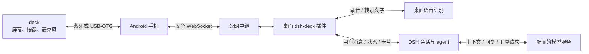

# 按住对讲机说句话，DeepSeek Harness 回了一个 7

上午 11:41，一台对讲机的屏幕上写着「快中午了，记得吃午饭」。仔细看，时间两边的 Markdown 星号都还在。电脑上的助手原样写下了这句话，我们把它送到了这块 480 × 480 的小屏幕上。

照片里是 OpenWalkieTalkie Rev A，下文叫它 deck。它有滚轮、麦克风和一颗按住说话的 PTT 键。我们想翻一翻助手刚做完的工作，在它等人拿主意时按一下键，再随口交代下一件事。这几件事，用手里的滚轮和按键就应该能做。难处在于，deck 没有 Wi-Fi，拔掉电脑上的 USB 线，它连会话名册都拿不到。

## 第一声 `hello` 是从一根线里传回来的

我们先用一根 USB-C 数据线把 deck 直接插到荣耀手机上。手机弹出授权窗口，点「允许」，应用向 deck 发出 `hello`。设备答了，回复里带着固件版本 `0.14.0`。后来我们又点了一次「开始测试」，第二次握手也成功了。这下可以让手机搬运报文，把已经调通的会话逻辑留在电脑上。

要把这根线也拔掉，还得过蓝牙这一关。手机能发现 deck，甚至能读出它的音频参数，可是在这台荣耀上，普通 Android 应用订阅蓝牙 HID 报告需要系统权限，写控制消息用的输出特征也找不到。麦克风已经近在眼前，连一句「把名册发过来」却送不进去。

于是我们在固件里加了一个加密的 GATT 控制服务。配对后，手机通过它发送名册、卡片，接收按键事件。声音继续走设备原有的蓝牙麦克风服务。现在同一个手机应用可以用蓝牙连接，也可以插回 USB 线。[设备协议](../firmware/docs/deck-protocol.md) · [手机端蓝牙实现](../android-otg/app/src/main/java/dev/dsh/otg/BleBridge.java)

## 跟着那个 7 走一遍

第一次确认语音真的进了会话，是在 USB-OTG 测试里。我们选中一个正在运行的助手，按住 PTT，说「请只回复数字七」，然后松手。桌面的对话记录里先多了一条用户消息，紧接着，助手回了一个 `7`。

按键按下时，电脑上的 `dsh-deck` 插件先记住选中的会话。deck 把人声压缩成一帧帧音频，手机经公网中继转发到电脑。松开按键后，插件给最后几帧留出一点时间，把收到的音频解码，交给桌面的语音识别服务。那次测试用的是 SenseVoice。识别出的文字会显示在 deck 上，也会作为一条正式的用户消息交给刚才选中的助手。[语音处理代码](../dsh-deck/lib/voice.mjs)

从这里开始，跟在电脑上敲一句话是同一个流程。DeepSeek Harness（DSH）保存会话记录。正在运行的助手，也就是 agent，把当前消息、之前的对话和可用工具交给这个会话配置的模型。模型可以直接回答，也可以请求使用工具。DSH 负责按权限执行，把工具结果记入会话，再交给模型继续。最后的回复由插件送回 deck。手机打开同一个会话，看到的也是这些消息。[DSH 的运行流程](https://github.com/Ivanbeethoven/deepseek-harness/blob/dsh-v0.2.1-rc.2/docs/architecture.md) · [插件入口](../dsh-deck/lib/index.mjs)

所以，手里这台 deck 已经可以靠电池和蓝牙工作，家里的电脑目前仍得开着。中继负责转发，运行 DSH、调用工具和转录语音的是电脑。

## 当助手在等你点头

我们给 deck 发过一张真的命令审批卡，标题是 `Allow pwsh?`。转动滚轮，选 `Reject`，按下确认。回到电脑一看，DSH 记下了 `rejected`，命令被挡住了。第二张卡选的是 `Allow once`，这次按键给出的许可只管眼前这一次请求。[审批卡片实现](../dsh-deck/lib/answerer.mjs)

提问也能在两块屏幕之间接着答。一次测试在 deck 上选了 `DECK_OK`。另一次我们让 deck 保持在线，直接在手机的同一会话里选 `BOTH_OK`。谁先提交，谁就回答了助手正在等的那个问题，另一端的卡片也会关闭。

用了一阵才发现，一个助手安静下来以后，反而更想知道它最后做了什么。最初的名册只列正在运行的 agent，刚结束的会话很难找。现在按左右方向键就能翻到「历史会话」，用滚轮挑一个，按 ENTER 读最近回复，再按一次看工作流。插件读的是保存下来的记录，已经停下来的助手可以接着休息。照片里的午饭提醒，就是在这样的回复页上读到的。[会话浏览实现](../dsh-deck/lib/session-browser.mjs)

## 第七次松开 PTT，屏幕还在听

蓝牙语音调试里，有一版固件连着录了六次都正常。第七次松手，屏幕停在「正在聆听」。那一次，电脑只收到了 20 帧音频，松键消息和录音结束标记都没到。此前我们已经试过放慢控制通知的发送速度。连着成功的那六次，很容易让人以为问题已经过去了。

后来我们改了固件发给蓝牙控制器的数据队列。空间够放下整个包时才一次写入，放不下就让出执行时间，稍后再试，最多等 500 毫秒。我们在电脑上构造了一个快写满的队列，测试剩余空间放不下整包时，写入位置会不会前移。真机复测时，我们说完、松手，又特意转了转滚轮。这次「正在聆听」消失了，滚轮有响应。此前三次卡死都没有留下芯片故障寄存器的记录，具体停在哪条指令上，仍然是个开放问题。[固件发送队列](../firmware/vendor/sifli-rs/sifli-hal/src/ipc/mod.rs) · [整包写入测试](../firmware/tools/tests/ipc_packet.rs)

屏幕底部显示着四个操作提示，依次是`ENTER 工作流`、`SCROLL 聊天`、`PTT 说话`、`CANCEL 返回`。想知道助手忙完了什么，就转一下滚轮。想接着跟它说话，就按住侧键。至于上午 11:41 的那条消息，读完正好去吃午饭。[项目首页与完整源码](../README.md)
