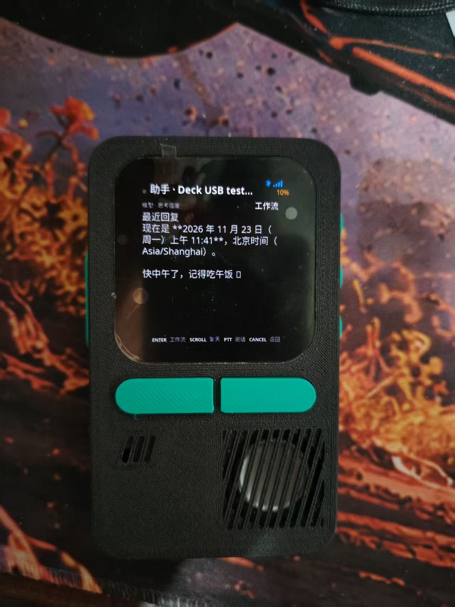
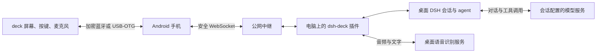

# 把 DeepSeek Harness 放进对讲机的屏幕里

照片里，助手刚回了一句「快中午了，记得吃午饭」。这句话原本属于电脑上的一个 DeepSeek Harness 会话，现在出现在一块 480 × 480 的屏幕上。转动滚轮可以继续读，按 ENTER 可以看这个助手最近做了什么。如果它正在等我批准一条命令，我也能在这里作决定。

屏幕上方的蓝牙图标透露了这套装置的连接方式。OpenWalkieTalkie Rev A 自带麦克风、滚轮、实体键和蓝牙，没有 Wi-Fi。要让它离开电脑还能用，我们让手机接手了原本由 USB 数据线承担的通信，再把手中的按键接回电脑上那个已经存在的会话。

## 谁负责哪一段

DeepSeek Harness（DSH）在电脑上管理会话。会话保存发生过的事情，包括用户消息、模型回复和工具结果。运行中的 agent 从这些记录组织上下文，把消息和可用工具一起发给配置的模型。如果模型请求使用工具，DSH 按当前权限执行或请求审批，再把工具结果带进下一次模型请求。一轮对话可以这样往返多次。[DSH 的会话与运行流程](https://github.com/Ivanbeethoven/deepseek-harness/blob/dsh-v0.2.1-rc.2/docs/architecture.md)

`dsh-deck` 是加载在同一个 DSH 里的插件。它把会话状态转成 deck 能画出来的名册，把提问和审批转成能用按键回答的卡片。手机上的后台服务负责转发 deck 的报文，会话页面则供人直接阅读和作答。两个入口最终访问同一套桌面会话。

公网中继解决的是手机如何从外网找到桌面 DSH。当前部署里，语音转录和工具执行都在电脑上完成。deck 可以拔掉电脑的 USB 线，用电池工作。要让电脑关机后仍能使用，还需要把 DSH 和它依赖的服务迁到常开的主机。

## 为什么先接了一次 USB

我们先把荣耀手机和 deck 用一根 USB-C 数据线直连。手机弹出 USB 访问授权后，应用向 HID 接口发了一条 `hello`。deck 回报固件版本 `0.14.0`。有了这次往返，我们就能让手机只负责双向收发，继续使用桌面插件原有的握手、名册和卡片代码。

换成蓝牙时，系统能发现 deck，也能读到音频参数，但在这台未取得 root 权限的荣耀手机上，普通应用订阅 HID 报告需要系统权限，也枚举不到对应的输出特征。于是我们给 Rev A 固件加了一个需要加密连接的 GATT 控制服务。手机订阅设备通知，再向写入特征发送控制数据。名册、卡片和按键走这个服务，麦克风沿用设备原有的音频服务。桌面仍然使用同一套控制消息，两种连接方式只在报文尺寸和传输方式上有差异。[设备协议](../firmware/docs/deck-protocol.md) · [Android 蓝牙实现](../android-otg/app/src/main/java/dev/dsh/otg/BleBridge.java)

## 一句语音怎样变成一轮对话

1. 在名册选一个正在运行的会话，按住 PTT。插件记下按键那一刻选中的会话 ID，接下来的录音就有了明确的接收者。
2. deck 发出录音开始标记和一串压缩音频帧。手机逐帧转发，桌面插件将 IMA ADPCM 解码成 16 kHz 单声道音频。松开按键时，控制消息和最后几帧音频可能先后到达，插件会短暂等待尾帧。
3. 插件把录音交给桌面 DSH 配置的 `speechToText` 服务。最初的真机测试用的是 SenseVoice。转录结果一份送回 deck 显示，一份通过 `agent.followup` 作为用户消息送进按键时选中的会话。
4. 模型的回复写入同一份会话记录。桌面插件把最近回复和工作流状态发回 deck，手机打开这个会话也能读到刚才的对话。

真机测试时，我们按住 PTT 说「请只回复数字七」，会话里先出现了一条用户消息，随后助手回复了 `7`。这同时验证了录音、转录和会话选择。如果只是看见屏幕上出现转录文字，还无法判断助手是否收到了它。[语音处理](../dsh-deck/lib/voice.mjs) · [插件与 DSH 的连接](../dsh-deck/lib/index.mjs)

## 同一个问题，两个地方都能答

agent 通过 `ask_user_question` 提出一个单选问题时，插件将题目和选项做成卡片。deck 上转动滚轮、按 ENTER，或在手机页面选择并提交，都能完成同一个请求。先提交的一端决定结果，另一个页面随之结束等待。多选题或过长的选项列表会交给 DSH 的其他答题界面。

工具审批则要传回一个特别明确的决定。我们用两张真实的命令审批卡测了两个方向。第一张选 `Reject`，DSH 记录拒绝，命令没有执行。第二张在 deck 上选 `Allow once`，这个选项仅对本次请求生效。卡片标题带上工具名，让按键的人能看出自己正在批准什么。[卡片与审批实现](../dsh-deck/lib/answerer.mjs)

## 停下来的助手也值得翻看

最初的名册只列正在运行的 agent。实际使用中，最想翻看的往往是刚结束的工作。插件现在把当前会话和已保存的会话列在同一份名册里。左右方向键切换分组，用滚轮选中会话，按 ENTER 读最近回复，再按一次看工作流状态和最近活动。读历史会话时，插件查询保存的记录，原来的 agent 可以继续保持停止状态。照片里显示的就是这套阅读界面。[会话分组与详情](../dsh-deck/lib/session-browser.mjs)

## 一次成功的录音还不够

调试中代价最高的一次故障发生在松开 PTT 前后。屏幕留在「正在聆听」，桌面在一次复现中只收到 20 帧音频，随后既没收到松键消息，也没收到录音结束标记。给蓝牙控制通知增加发送间隔后，前六次录音都正常，第七次又出现了同样的现象。

我们随后修正了固件向蓝牙控制器写入数据包的方式。发送队列有足够空间时才把整个包交给控制器，空间不足时让出执行时间并重试，最多等待 500 毫秒。修正后的真机测试里，松开 PTT 后屏幕退出「正在聆听」，滚轮也能继续操作。此前卡死时没有采集到芯片的故障寄存器，所以还无法把三次故障都归因于同一处代码。[固件发送队列](../firmware/vendor/sifli-rs/sifli-hal/src/ipc/mod.rs) · [整包写入测试](../firmware/tools/tests/ipc_packet.rs)

现在，读一条旧回复、回答助手的问题、为当前会话补一句话，都可以在同一块小屏幕上完成。想从代码跟一次完整的交互，可以从 Android 收到的第一个蓝牙通知开始，沿着桌面插件一直读到 DSH 会话。[项目首页与源码目录](../README.md)
